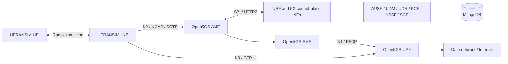

# Open5GS + UERANSIM on Kubernetes

[](https://github.com/lazypanic999/open5gs-ueransim-kubernetes/actions/workflows/validate.yml)


[](LICENSE)

A reproducible 5G Standalone lab that deploys an Open5GS core and a simulated UERANSIM gNB/UE on a local Kubernetes cluster. The project turns a manually validated WSL2/Minikube experiment into a documented, repeatable workflow with pinned Helm chart versions and automated checks.

> [!IMPORTANT]
> This repository is an educational lab. It is not hardened for production, emergency services, or public mobile-network use.

## What this demonstrates

- Cloud-native deployment of Open5GS network functions as Kubernetes workloads
- N1/N2 signaling over NGAP/SCTP and N3 user-plane traffic over GTP-U
- UE registration, authentication, and PDU session establishment
- Internet reachability through the simulated `uesimtun0` interface
- Practical diagnosis of PLMN, SCTP, GTP-U, NAT, and pod-startup failures

## Architecture



For interface-level details, see [Architecture](docs/architecture.md).

## Tested baseline

| Component | Baseline |
| --- | --- |
| Host | Windows 11 + WSL2 Ubuntu 24.04 |
| Local cluster | Minikube, Docker driver, 4 CPUs, 8 GiB RAM |
| Open5GS chart | Gradiant `open5gs` `2.3.4` |
| Open5GS app | `2.7.5` |
| UERANSIM chart | Towards5GS `ueransim` `2.0.17` |
| PLMN | MCC `999`, MNC `70` |
| Slice | SST `1` |
| DNN/APN | `internet` |

The deployment defaults to the Kubernetes pod network and the Open5GS AMF SCTP service. This avoids the `ipvlan` address collision observed during the original Minikube experiment. Multus remains useful for realistic N2/N3 separation and is covered in [Troubleshooting](docs/troubleshooting.md#multus-and-secondary-networks).

## Prerequisites

- Linux or WSL2
- Docker
- Minikube
- Kubernetes CLI (`kubectl`)
- Helm 3
- `curl`

Run the preflight check before changing the cluster:

```bash
./scripts/preflight.sh
```

## Quick start

Create the cluster, deploy the core and simulator, then validate the data path:

```bash
./scripts/cluster-up.sh
./scripts/deploy.sh
./scripts/verify.sh
```

Equivalent Make targets are available:

```bash
make preflight
make cluster
make deploy
make verify
```

The deployment uses the `open5gs` namespace and these Helm releases:

- `open5gs` - 5G core and MongoDB
- `ueransim` - simulated gNB and UE

## Demo subscriber

The values files contain the public UERANSIM/Open5GS lab identity used by upstream examples. These values are not real subscriber credentials.

| Field | Value |
| --- | --- |
| SUPI / IMSI | `imsi-999700000000001` / `999700000000001` |
| MCC / MNC | `999` / `70` |
| Key | `465B5CE8B199B49FAA5F0A2EE238A6BC` |
| OPc | `E8ED289DEBA952E4283B54E88E6183CA` |
| AMF | `8000` |

Do not reuse these values outside an isolated lab. Replace both the Open5GS subscriber and UERANSIM configuration together if you customize them.

## Verification

`scripts/verify.sh` performs four checks:

1. Kubernetes workloads become ready.
2. UERANSIM logs contain a successful registration.
3. UERANSIM logs contain a successful PDU session.
4. The UE reaches `8.8.8.8` through `uesimtun0` with zero packet loss.

Inspect the lab manually when needed:

```bash
kubectl get pods -n open5gs
kubectl logs -n open5gs deploy/ueransim-ue --tail=100
kubectl exec -n open5gs deploy/ueransim-ue -- ip address show uesimtun0
kubectl exec -n open5gs deploy/ueransim-ue -- ping -I uesimtun0 8.8.8.8 -c 5
```

Open the WebUI locally:

```bash
kubectl port-forward -n open5gs svc/open5gs-webui 9999:9999
```

Then visit `http://localhost:9999`. Change the upstream default WebUI credentials immediately if the service is ever exposed beyond localhost.

## Repository layout

```text
.
|-- .github/workflows/validate.yml  # CI checks
|-- docs/
|   |-- architecture.md             # Protocol and component map
|   |-- lab-notes.md                # Evidence captured in the original lab
|   `-- troubleshooting.md          # Failure patterns and fixes
|-- scripts/
|   |-- cluster-up.sh               # Minikube bootstrap
|   |-- deploy.sh                   # Idempotent Helm deployment
|   |-- preflight.sh                # Dependency and context checks
|   |-- teardown.sh                 # Explicit cleanup
|   `-- verify.sh                   # End-to-end validation
|-- values/
|   |-- open5gs.yaml                # 5G-only core and subscriber
|   `-- ueransim.yaml               # gNB and UE settings
`-- Makefile
```

## Cleanup

Remove only the lab releases and namespace:

```bash
./scripts/teardown.sh
```

Delete the dedicated Minikube profile as well:

```bash
DELETE_CLUSTER=true ./scripts/teardown.sh
```

## Known limitations

- The Towards5GS UERANSIM chart declares `appVersion: latest`; the chart version is pinned, but its upstream simulator images are not immutable.
- A single-node Minikube cluster does not reproduce multi-node latency, failure domains, or production-grade networking.
- The public demo subscriber is suitable only for isolated development environments.
- The default path favors reliable local execution over physically separate N2 and N3 interfaces.

## Credits

Lab implementation and report by Doğukan Sağlık and Alperen Gül. The deployment builds on [Open5GS](https://open5gs.org/), [UERANSIM](https://github.com/aligungr/UERANSIM), [Gradiant 5G Charts](https://github.com/Gradiant/5g-charts), and [Towards5GS Helm](https://github.com/Orange-OpenSource/towards5gs-helm).

Third-party projects retain their own licenses. See [NOTICE](NOTICE).
